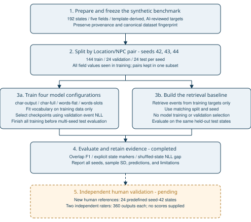

# World-State-Conditioned Game Event Generation

**A controlled study of retrieval, character-prefix models, and word-level conditional Transformers**

Pin Guang Shih

National Yang Ming Chiao Tung University

Advisor: Te-Sheng Lin

## Abstract

This project studies short English game-event generation conditioned on five world-state fields: Location, Time, Player, NPC, and Weather. An initial character-level model trained on 135 handcrafted examples performed worse than retrieval, motivating a denser benchmark and a conditional word-level decoder. We constructed a separate 192-state, template-derived, AI-reviewed synthetic benchmark and held out Location/NPC pairs while retaining all individual field values in training. Four model configurations were compared across three seeds with matching retrieval baselines. Word-flat achieved mean token-overlap F1 of 0.904 (sample SD 0.014), compared with 0.728 (SD 0.079) for retrieval and 0.430 (SD 0.116) for the output-loss character model. Both word models achieved perfect explicit NPC-marker accuracy. Explicit field memory did not show a clear overall advantage over flat word memory. These findings support improved handling of this controlled template task, rather than a claim about open-ended creativity or human-rated narrative quality. Independent-reference collection and two-reviewer evaluation tooling are implemented, but no human targets or ratings have been supplied for those studies.

## 1. Problem and Research Questions

The input is a structured world state and the output is one plausible, short event. A useful event should respect important state conditions, be readable, and offer an interaction suitable for a game. The implemented system generates text only; it does not update a game simulation, enforce an executable action schema, or model long-term consequences.

The completed study addresses three questions:

1. How do character-prefix and word-level conditional pipelines compare with retrieval on a small controlled benchmark?
2. With the word architecture and capacity held constant, does explicit field memory improve performance over flat state text?
3. How do overlap, explicit state markers, and shuffled-state likelihood diagnostics characterize failures on held-out Location/NPC pairs?

The character output-only versus full-sequence comparison additionally examines training objectives. The earlier original-data random/compositional experiment matrix remains a separate unfinished extension; it is not required for the narrower synthetic study reported here.

### Research Workflow



**Figure 1. Research workflow.** Solid stages represent the completed synthetic study. The dashed final stage represents prepared but uncompleted human validation. Training vocabularies and retrieval targets use training data only; checkpoints are selected on validation data. Shared templates and previously inspected test results remain limitations of this exploratory benchmark.

## 2. Related Work and Positioning

The Transformer provides attention-based sequence modeling and encoder-decoder attention, which underlies the conditional decoder used here. The project implements small models using standard PyTorch components and does not introduce a new attention architecture. [Vaswani et al., *Attention Is All You Need*, 2017](https://arxiv.org/abs/1706.03762).

Lake and Baroni investigate whether sequence models recombine familiar components under controlled generalization tests. This motivates separating unseen combinations from unseen individual values. Our Location/NPC holdout is a limited analogous diagnostic, not a replication of SCAN or a general demonstration of systematic compositionality. [Lake and Baroni, *Generalization without Systematicity*, 2018](https://proceedings.mlr.press/v80/lake18a.html).

OpenMEVA studies evaluation metrics for open-ended story generation and reports weaknesses in their alignment with human judgments. This supports treating overlap scores as diagnostics and retaining an independent human evaluation plan. Our task is much shorter and more constrained than open-ended story generation, and our F1 is not a validated narrative-quality metric. [Guan et al., *OpenMEVA*, 2021](https://aclanthology.org/2021.acl-long.500/).

STORIUM combines collaborative storytelling data with evaluation of generated suggestions in a writing workflow. It highlights richer context and user-centered evaluation absent from this project. Our study uses synthetic states and no player or writer interaction study, so it does not establish practical usefulness in a live game. [Akoury et al., *STORIUM*, 2020](https://aclanthology.org/2020.emnlp-main.525/).

The project's contribution is a reproducible controlled evaluation, explicit provenance, matched representation comparison, and analysis of low-data generation failures. This focused literature review establishes context; it is not an exhaustive novelty review. No methodological novelty is claimed.

## 3. Data and Provenance

### 3.1 Original course dataset

`data/dataset.json` retains 135 handcrafted state/event pairs. Inspection found 102 Location values, 49 NPC values, and 124 Location/NPC pairs. This sparsity makes it difficult to hold out combinations without also withholding individual values. The original dataset is retained separately and is not merged into the synthetic benchmark.

### 3.2 Controlled synthetic benchmark

`data/dense_ai_reviewed.json` contains the full Cartesian product of four locations, two times, three player conditions, four NPCs, and two weather conditions: 4 × 2 × 3 × 4 × 2 = 192 states. Locations are forest, village, cave, and river; NPCs are hunter, merchant, healer, and traveler. Times are morning/night, player conditions healthy/injured/hungry, and weather clear/rainy.

Targets are rule-template outputs with AI review and corrections. Their source is `rule_template_ai_reviewed`; review kind is `ai`. Shared linguistic templates cross split boundaries. This benchmark measures recombination within a narrow synthetic distribution, not independently authored narrative diversity. The original human annotation sheet remains separate and incomplete.

The frozen canonical-data SHA-256 is:

```text
a88767802aa5e7df2393b837c3a27558a07a7a5e674873f0210e572c00d76ef8
```

### 3.3 Split protocol

The `compositional_seen` protocol groups by Location/NPC pair and keeps each pair in only one subset. For each seed, the synthetic data has 144 training, 24 validation, and 24 test examples. Every field value used in validation/test remains represented in training. Vocabularies are fitted on training data only. Split indices and coverage diagnostics are retained in manifests.

Seeds 42, 43, and 44 vary both split membership and model initialization. Reported standard deviations therefore combine these sources of variation. Earlier benchmark test results were already inspected. The multi-seed settings were frozen before its test phase, but this remains an exploratory benchmark, not an untouched confirmatory test.

## 4. Methods

| Method | Input representation and objective | Parameters |
|---|---|---:|
| Retrieval | Training event with the greatest number of matching state fields; deterministic tie handling | N/A |
| char-output | Causal character-prefix Transformer; loss on event/EOS tokens | 1,230,381 |
| char-full | Same character architecture; full-sequence training loss | 1,230,381 |
| words-flat | Word/punctuation state memory; event-only conditional decoder | 160,755 |
| words-slots | Five field-value vectors; event-only conditional decoder | 160,755 |

Character models use embedding size 128, two layers, and context size 256. Dedicated PAD, UNK, and EOS tokens correct the historical tokenizer behavior. Word models use embedding size 64, four heads, two decoder layers, feed-forward size 256, dropout 0.1, and position tables of length 96. Cross-attention supplies condition information during event decoding.

Flat memory contains canonical state words and punctuation. Slot memory averages each field value's token embeddings and uses a fixed position to identify the field. The two word models share architecture, parameter count, optimizer, and seed choices; their comparison tests memory construction. Comparing character and word models simultaneously changes tokenization, architecture, conditioning, and capacity, so it cannot isolate any one factor.

Runs use AdamW with learning rate 0.0003, batch size 16, gradient clipping at 1, a 100-epoch maximum, and patience 15. Checkpoints are selected by validation event NLL. All training/validation runs finish before the runner's separate test phase. Decoding is greedy; the word decoder generates at most 60 word/punctuation tokens and the character evaluation uses its documented generation cap. This difference is another pipeline-level comparison limitation.

## 5. Evaluation

Token-overlap F1 compares word-count multisets in prediction and reference. Explicit NPC/player accuracy requires the desired marker and rejects competing domain values; missing markers fail. Supplemental location/time/weather checks recognize phrases tied to the synthetic generator. These metrics can penalize valid paraphrases and do not measure causal plausibility or creativity.

Other retained diagnostics include exact match, training-copy rate, distinct-2, empty outputs, length, event NLL, and the shuffled-state NLL gap. The latter subtracts correct-state NLL from shuffled-state NLL: a positive gap indicates a likelihood advantage for the correct condition under this diagnostic. Character and word NLL have different token units and must not be compared directly.

There is one reference per state. Alternate valid actions may have low overlap. A low copy rate does not establish novelty, and perfect lexical markers do not establish full semantic consistency.

## 6. Results

Values are mean ± sample SD across three runs, each with 24 test items.

| Method | NPC marker accuracy | Player marker accuracy | Token-overlap F1 |
|---|---:|---:|---:|
| char-output | 0.000 ± 0.000 | 0.083 ± 0.000 | 0.430 ± 0.116 |
| char-full | 0.000 ± 0.000 | 0.083 ± 0.110 | 0.456 ± 0.129 |
| words-flat | 1.000 ± 0.000 | 0.986 ± 0.024 | 0.904 ± 0.014 |
| words-slots | 1.000 ± 0.000 | 1.000 ± 0.000 | 0.894 ± 0.024 |
| retrieval | 0.667 ± 0.289 | 1.000 ± 0.000 | 0.728 ± 0.079 |

Both word models achieved 1.000 location, time, and weather phrase accuracy across the three runs. Retrieval location accuracy was 0.333 ± 0.289, despite perfect time/weather phrase scores. Thus, overlap alone can obscure a wrong location or actor.

Word-model shuffled-state gaps were positive in all runs: flat 1.1245, 0.8947, and 1.1786; slots 1.2577, 0.9953, and 1.2367. Character-model gaps changed sign across seeds. These diagnostics support stronger conditioning within the synthetic distribution, without establishing general narrative quality.

Word-flat has the higher mean F1, while word-slots has perfect player markers versus 0.986 for flat. Three runs do not establish statistical superiority. Full-sequence character training also shows no clear advantage over event-only training in these results.

The initial original-data seed-42 random-split experiment used 95/20/20 examples and selected epoch 14 before stopping at epoch 29. Its Transformer F1 was 0.1190 versus retrieval 0.3453, and the conditioning gap was -0.00686. These are historical results from a different dataset and protocol; they must not be pooled with the synthetic study. See [Initial Results](INITIAL_RESULTS.md).

## 7. Error Analysis and Interpretation

The original-data character model produced incomplete words and repeated fragments, including a desert example beginning “A therer the there the the the player ...”. Synthetic character outputs also had weak explicit actor markers. This motivates evaluating readability separately from whether a complete training sentence was copied.

Retrieval returns fluent training events but may select an incompatible Location/NPC pair. Its weaker actor and location marker scores illustrate this failure. The word pipeline handles template recombination more reliably; however, generator-derived phrases favor its narrow target grammar. These observations are automated diagnostics and inspected examples, not a completed human-coded error taxonomy.

The best-supported finding is the effectiveness of the word-level conditional pipeline for this controlled low-data template task. There is no clear benefit from field memory alone, and no evidence yet about player engagement or open-ended creative quality.

## 8. Human Validation: Prepared, Not Completed

The predefined independent-reference sheet contains 24 seed-42 held-out states and blank human targets. One human author and a different checker must supply events and provenance. The evaluator validates complete coverage, held-out pairs, seen values, and frozen checkpoints, then compares word-flat, word-slots, and retrieval without retraining. This adds independently authored references for existing synthetic states, not new environments.

Two separately shuffled 360-item sheets cover five systems, three seeds, and 24 items per seed. Independent raters score state consistency, coherence, and interestingness from 1 to 5. The analyzer validates unchanged items and complete scores, requires distinct reviewer IDs, and reports descriptive averages and disagreement only after complete collection. Identity and independence remain collection responsibilities.

At report preparation, both sheets contained zero completed ratings. No human-quality averages, agreement results, or independent-reference scores are reported. Instructions, invitations, and commands are in [Final Validation](FINAL_VALIDATION.md) and [Participant Handoff](PARTICIPANT_HANDOFF.md).

## 9. Reproducibility and Artifact Map

The implementation runs in WSL with `.venv-wsl` and CPU execution. Seventeen tests passed in the latest code verification. Historical NumPy and GPU-driver warnings did not prevent these CPU runs. Software versions and parameters are recorded per run; results may differ across library versions or hardware.

```bash
source .venv-wsl/bin/activate
python -m unittest discover -s model -p 'test_*.py'
OMP_NUM_THREADS=2 MKL_NUM_THREADS=2 python model/run_conditioning.py --phase train
OMP_NUM_THREADS=2 MKL_NUM_THREADS=2 python model/run_conditioning.py --phase test
python model/report_conditioning.py
```

The runner reuses verified completed runs and rejects changed frozen plans or incomplete histories. Checkpoints remain in local ignored `results/` directories; copied evidence under `docs/conditioning_results/` contains manifests, histories, metrics, predictions, and the frozen plan. Regenerating from source requires the training environment; distributing only the report does not distribute checkpoints.

| Artifact | Purpose |
|---|---|
| [Conditioning Results](CONDITIONING_RESULTS.md) | Detailed measured results and per-run checkpoints |
| [Experiment Protocol](CONDITIONING_EXPERIMENT.md) | Configuration, commands, and generation demonstration |
| [Synthetic Benchmark](SYNTHETIC_BENCHMARK.md) | Data provenance and preparation |
| [Initial Results](INITIAL_RESULTS.md) | Historical original-data experiment |
| [Final Validation](FINAL_VALIDATION.md) | Pending human collection and analysis commands |
| [Research Experience](RESEARCH_EXPERIENCE.md) | Resume and research-statement wording |

## 10. Limitations and Research Scope

The dataset is small, artificial, template-derived, and previously inspected. Held-out pairs still share templates and all field values with training. Three seeds and 24 test items per run do not justify broad significance claims; repeated states further limit item-level independence. Greedy decoding and one reference constrain evaluation. Cross-pipeline gains confound several model choices. No independent human ratings, new-environment test, deployment study, or exhaustive novelty review has been completed.

The completed deliverable is a controlled synthetic research prototype with traceable evaluation. Remaining validation consists of genuine human references and ratings. Optional extensions include the original-data matrix, parameter/tokenization controls, new environments, multiple references, and interactive user evaluation. These extensions should use predefined protocols and avoid tuning on their final tests.

## 11. Conclusion

A reproducible synthetic comparison shows that word-level conditional decoders handle held-out Location/NPC combinations more reliably than the tested character-prefix models and retrieval on lexical diagnostics. Explicit field memory does not show a clear general advantage over flat memory. The study supports a measured research-project description, with human validation and broader narrative claims reserved for future evidence.
